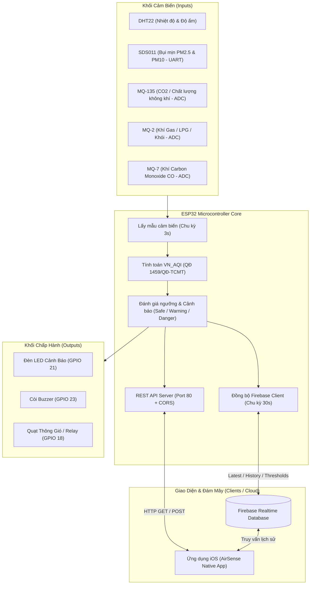

# Hệ Thống Giám Sát Chất Lượng Không Khí Thông Minh (ESP32 Air Quality Monitor — AirSense)

Hệ thống IoT toàn diện giám sát chất lượng không khí trong nhà và ngoài trời theo thời gian thực dựa trên vi điều khiển **ESP32**, hỗ trợ chuẩn chỉ số chất lượng không khí Việt Nam (**VN_AQI**), tích hợp cơ chế cảnh báo tự động đa cấp độ (LED, Buzzer, Quạt thông gió), đồng bộ dữ liệu đám mây **Firebase Realtime Database** và ứng dụng di động **iOS AirSense**.

---

## Mục Lục

- [1. Kiến Trúc Tổng Thể](#1-kiến-trúc-tổng-thể)
- [2. Danh Sách Phần Cứng & Sơ Đồ Chân (Pinout)](#2-danh-sách-phần-cứng--sơ-đồ-chân-pinout)
- [3. Tính Năng Kỹ Thuật Nổi Bật](#3-tính-năng-kỹ-thuật-nổi-bật)
- [4. Cấu Trúc Mã Nguồn (Project Structure)](#4-cấu-trúc-mã-nguồn-project-structure)
- [5. Hướng Dẫn Cài Đặt & Nạp Firmware ESP32](#5-hướng-dẫn-cài-đặt--nạp-firmware-esp32)
- [6. Bộ Giả Lập Python (ESP32 Simulator)](#6-bộ-giả-lập-python-esp32-simulator)
- [7. Ứng Dụng Di Động iOS (AirSense)](#7-ứng-dụng-di-động-ios-airsense)
- [8. Tổng Quan REST API & Đồng Bộ Firebase](#8-tổng-quan-rest-api--đồng-bộ-firebase)
- [9. Hướng Dẫn Hiệu Chuẩn Cảm Biến Khí (Calibration)](#9-hướng-dẫn-hiệu-chuẩn-cảm-biến-khí-calibration)

---

## 1. Kiến Trúc Tổng Thể



---

## 2. Danh Sách Phần Cứng & Sơ Đồ Chân (Pinout)

### 2.1. Danh Sách Linh Kiện Phần Cứng
- **Vi điều khiển**: ESP32 NodeMCU-32S (30 chân).
- **Cảm biến nhiệt độ & độ ẩm**: DHT22 (AM2302) — độ chính xác cao.
- **Cảm biến bụi mịn Laser**: Nova Fitness SDS011 (đo kích thước hạt PM2.5 và PM10 qua giao tiếp UART).
- **Cảm biến khí chuyên dụng**:
  - **MQ-135**: Đo nồng độ $CO_2$ và các hợp chất độc hại trong không khí.
  - **MQ-2**: Đo khí dễ cháy, rò rỉ khí gas LPG, propan, mêtan, khói.
  - **MQ-7**: Đo nồng độ khí Carbon Monoxide ($CO$).
- **Cơ cấu chấp hành & Cảnh báo**:
  - Đèn LED báo trạng thái trực quan.
  - Còi chip / Buzzer phát âm thanh cảnh báo nguy hiểm.
  - Module Relay điều khiển Quạt thông gió hút khí (Fan DC/AC).

### 2.2. Bảng Đấu Nối Chân GPIO (ESP32 Pinout)

| Thiết bị / Cảm biến | Chân trên Module | Chân nối trên ESP32 | Giao thức / Loại tín hiệu | Ghi chú |
|---|---|---|---|---|
| **DHT22** | DATA / OUT | **GPIO 4** | 1-Wire Digital | Kèm trở kéo lên 4.7kΩ–10kΩ lên 3.3V |
| **MQ-135** | AO (Analog Out) | **GPIO 32** | ADC1_CH4 (12-bit) | Điện áp ADC 0–3.3V (0–4095) |
| **MQ-2** | AO (Analog Out) | **GPIO 35** | ADC1_CH7 (12-bit) | Chân Input-only trên ESP32 |
| **MQ-7** | AO (Analog Out) | **GPIO 34** | ADC1_CH6 (12-bit) | Chân Input-only trên ESP32 |
| **SDS011** | TXD | **GPIO 16 (RX2)** | HardwareSerial 2 | Nhận dữ liệu frame bụi từ SDS011 |
| **SDS011** | RXD | **GPIO 17 (TX2)** | HardwareSerial 2 | Gửi lệnh cấu hình tới SDS011 |
| **LED** | Anode (+) | **GPIO 21** | Digital Output | Sáng khi Warning hoặc Danger |
| **Buzzer** | Tín hiệu kích | **GPIO 23** | Digital Output | Kêu khi Danger ($\ge 100\%$ ngưỡng) |
| **Relay / Quạt** | IN | **GPIO 18** | Digital Output | Kích hoạt quạt thông gió khi Danger |

> [!NOTE]
> Cả 3 cảm biến dòng MQ đều sử dụng các chân ADC thuộc **ADC1** (GPIO 32, 34, 35) của ESP32 để không bị xung đột khi bật module WiFi (ADC2 sẽ bị khóa khi WiFi hoạt động).

---

## 3. Tính Năng Kỹ Thuật Nổi Bật

1. **Thu Thập Cảm Biến Đa Chỉ Số Độc Lập**:
   - Tần số lấy mẫu: 3 giây/lần (`SENSOR_INTERVAL_MS = 3000`).
   - Xử lý nồng độ khí MQ chính xác qua đường đặc tuyến lũy thừa:
     $$\text{ppm} = a \cdot \left(\frac{R_s}{R_0}\right)^b$$
   - Đọc dữ liệu bụi mịn SDS011 theo frame nhị phân 10-byte chuẩn (`0xAA ... 0xC0`), kiểm tra Checksum đảm bảo không sai lệch dữ liệu.
2. **Tính Toán Chỉ Số VN_AQI Chuẩn Quốc Gia**:
   - Cài đặt thuật toán nội suy chỉ số chất lượng không khí Việt Nam **VN_AQI** dựa trên **Quyết định 1459/QĐ-TCMT** (Tổng cục Môi trường — Bộ TN&MT).
   - Nội suy độc lập theo các thông số: PM2.5, PM10 và CO ($1 \text{ ppm CO} \approx 1145 \ \mu\text{g/m}^3$), lấy giá trị lớn nhất trong các chỉ số thành phần ($0 - 500$).
   - Phân loại rõ ràng 6 cấp độ: *Tốt (0-50), Trung bình (51-100), Kém (101-150), Xấu (151-200), Rất xấu (201-300), Nguy hại (301-500)*.
3. **Cơ Chế Cảnh Báo Thông Minh 3 Cấp Độ (Alert Engine)**:
   - **Mức An Toàn (`safe`)**: Các chỉ số dưới ngưỡng cảnh báo an toàn.
   - **Mức Cảnh Báo (`warning`)**: Khi bất kỳ chỉ số nào đạt $\ge 80\%$ ngưỡng cấu hình $\rightarrow$ Tự động bật đèn LED (GPIO 21).
   - **Mức Nguy Hiểm (`danger`)**: Khi bất kỳ chỉ số nào vượt $\ge 100\%$ ngưỡng $\rightarrow$ Đèn LED sáng, Còi Buzzer kêu, Quạt thông gió kích hoạt.
   - Hỗ trợ 3 chế độ hoạt động cho từng thiết bị ngoại vi: Tự động (`auto`), Ép bật (`on`), Ép tắt (`off`).
4. **Hiệu Chuẩn $R_0$ Động (Dynamic Calibration)**:
   - Hiệu chuẩn lại điện trở không khí sạch $R_0$ đồng thời cho cả 3 cảm biến MQ trực tiếp khi đang chạy mà **không cần nạp lại firmware**.
   - Hỗ trợ kích hoạt qua Serial Monitor (gõ `calib`), qua REST API (`POST /api/calibrate`), hoặc trên ứng dụng iOS App.
5. **Đồng Bộ Hai Chiều Với Firebase Realtime Database**:
   - `esp32/latest`: Luôn ghi đè bản ghi mới nhất.
   - `esp32/history`: Đẩy từng bản ghi vào chuỗi thời gian (mỗi 30s) phục vụ phân tích dữ liệu lịch sử.
   - `esp32/thresholds`: Tự động tải lại ngưỡng khi khởi động lại và lưu tức thì các thay đổi từ API / iOS App.

---

## 4. Cấu Trúc Mã Nguồn (Project Structure)

```
IoT_chat_luong_khong_khi/
├── README.md               # Tài liệu tổng quan dự án (file này)
├── API.md                  # Đặc tả chi tiết các endpoint REST API & Firebase schema
├── esp32_simulator.py      # Bộ giả lập vi điều khiển ESP32 bằng Python
│
├── esp32_server/           # Source code Firmware ESP32 (Arduino C++)
│   ├── main.ino            # Điểm khởi chạy setup(), loop() và điều phối tác vụ
│   ├── Config.h            # Cấu hình chân GPIO, WiFi, Firebase, chu kỳ, hệ số MQ
│   ├── Types.h             # Định nghĩa struct (MqSensor, Reading, Actuator) & enum
│   ├── Sensors.h/.cpp      # Khởi tạo cảm biến, đọc SDS011 UART, tính VN_AQI, hiệu chuẩn R0
│   ├── Actuators.h/.cpp    # Điều khiển LED, Buzzer, Quạt Fan (GPIO 18)
│   ├── AppNetwork.h/.cpp   # Quản lý WiFi Station, tạo JSON và đồng bộ Firebase
│   ├── ServerRoutes.h/.cpp # Khởi tạo HTTP WebServer port 80, định tuyến REST API & CORS
│   └── SerialReporter.h/.cpp # Log định dạng Serial Monitor (115200) & nhận lệnh Serial
│
└── AirSense/               # Ứng dụng iOS Native (Objective-C)
    ├── Application/        # Root View Controller, App Delegate, Navigation glass bar
    ├── Components/         # Các custom UI components, biểu đồ ASChartView, thẻ Glassmorphism
    ├── Design/             # Thiết kế màu sắc khí hậu, phông chữ, bảng màu AQI
    ├── Models/             # Cấu trúc dữ liệu snapshot, lịch sử chuỗi thời gian, cảm biến
    ├── Services/           # ASAPIClient (REST + Firebase), ASMonitor, Thông báo đẩy
    ├── UI/                 # Màn hình Dashboard, Air Quality, History, Alerts, Settings
    └── Utils/              # Bộ giải mã JSON, chuyển đổi định dạng
```

---

## 5. Hướng Dẫn Cài Đặt & Nạp Firmware ESP32

### 5.1. Chuẩn Bị Môi Trường
1. Cài đặt **Arduino IDE**.
2. Thêm board ESP32 vào Arduino IDE:
   - Vào `File` $\rightarrow$ `Preferences`.
   - Thêm URL: `https://raw.githubusercontent.com/espressif/arduino-esp32/gh-pages/package_esp32_index.json` vào mục *Additional Boards Manager URLs*.
   - Mở `Boards Manager`, tìm kiếm và cài đặt gói **esp32** của Espressif Systems.

### 5.2. Cài Đặt Các Thư Viện Cần Thiết
Vào **Library Manager** trên Arduino IDE (`Ctrl + Shift + I`) và cài đặt:
1. `DHT sensor library` (bởi Adafruit) kèm `Adafruit Unified Sensor`.
2. `MQUnifiedsensor` (bởi Miguel Califa).
3. `Firebase ESP32 Client` (hoặc thư viện Firebase RTDB tương thích với kiến trúc ESP32).

### 5.3. Cấu Hình & Nạp Code
1. Mở file [esp32_server/Config.h](esp32_server/Config.h).
2. Chỉnh sửa thông tin kết nối mạng và Firebase của bạn:
   ```cpp
   #define WIFI_SSID     "Ten_WiFi_Cua_Ban"
   #define WIFI_PASSWORD "Mat_Khau_WiFi"

   #define FB_URL    "https://your-project-id.firebasedatabase.app"
   #define FB_TOKEN  "Your_Firebase_Database_Secret"
   ```
3. Trong mục `Tools` của Arduino IDE:
   - **Board**: Chọn `ESP32 Dev Module` (hoặc `NodeMCU-32S`).
   - **Upload Speed**: `921600` hoặc `115200`.
   - **Port**: Chọn đúng cổng COM của mạch ESP32.
4. Bấm **Upload**.
5. Mở **Serial Monitor** với baudrate **115200**. ESP32 sẽ in thông tin khởi động và địa chỉ IP được cấp phát từ Router:
   ```text
   [WiFi] OK - IP: 192.168.1.100
   [HTTP] Server: http://192.168.1.100:80
   ```

---

## 6. Bộ Giả Lập Python (ESP32 Simulator)

Dự án cung cấp file [esp32_simulator.py](esp32_simulator.py) giả lập 100% hoạt động phần cứng của ESP32, cho phép phát triển ứng dụng di động và kiểm thử hệ thống mà không cần cắm mạch thật.

### 6.1. Chạy Simulator
Yêu cầu Python 3.8+:
```bash
# Chạy simulator ở cổng mặc định 8080
python esp32_simulator.py --port 8080

# Chạy không đồng bộ Firebase (chế độ offline)
python esp32_simulator.py --port 8080 --no-firebase
```

### 6.2. Lệnh Tương Tác Qua Console
Khi simulator đang chạy, bạn có thể gõ trực tiếp các lệnh sau vào terminal:
- `status`: Xem toàn bộ thông số môi trường hiện tại.
- `spike gas <val>`: Giả lập sự cố rò rỉ khí gas đột ngột (ví dụ: `spike lpg 500` hoặc `spike co2 2000`).
- `spike dust <pm25>`: Giả lập sự cố khói bụi đột biến.
- `calib`: Chạy chu trình giả lập hiệu chuẩn $R_0$ trong không khí sạch.
- `led on` / `led off` / `led auto`: Điều khiển đèn LED.
- `fan on` / `fan off` / `fan auto`: Điều khiển quạt.
- `buzzer on` / `buzzer off` / `buzzer auto`: Điều khiển còi.

---

## 7. Ứng Dụng Di Động iOS (AirSense)

Thư mục [AirSense/](AirSense/) là dự án ứng dụng iOS được xây dựng bằng Objective-C với giao diện kính mờ mượt mà (Glassmorphism), cung cấp trải nghiệm theo dõi toàn diện:

- **Dashboard**: Màn hình tổng quan với thẻ kính nổi hiển thị trạng thái kết nối, mức cảnh báo, đồng hồ nồng độ khí và bụi mịn.
- **Air Quality (VN_AQI)**: Thang đo chỉ số VN_AQI trực quan, phân tích mức độ ảnh hưởng sức khỏe và đưa ra khuyến cáo phù hợp.
- **History**: Vẽ biểu đồ đường biến thiên theo thời gian (Line Chart), tự động truy vấn dữ liệu từ node `esp32/history` trên Firebase theo khoảng thời gian tùy chọn (24 giờ, 7 ngày, 30 ngày).
- **Alerts**: Quản lý lịch sử và trạng thái cảnh báo vượt ngưỡng.
- **Settings**: Cấu hình địa chỉ IP ESP32, thiết lập URL và Database Secret của Firebase (được mã hóa lưu trữ an toàn trong iOS Keychain), chỉnh sửa ngưỡng cảnh báo và gửi lệnh hiệu chuẩn $R_0$.

---

## 8. Tổng Quan REST API & Đồng Bộ Firebase

*(Chi tiết đầy đủ xem tại file [API.md](API.md))*

### 8.1. Các Endpoint Chính (HTTP Port 80)

| Method | Endpoint | Mô tả chức năng |
|---|---|---|
| `GET` | `/api/data` | Lấy toàn bộ trạng thái hệ thống (Uptime, WiFi, Env, Dust, Gas, AQI, Alert, Firebase, Thresholds) |
| `GET` | `/api/mq` | Lấy danh sách thông số chi tiết của cả 3 cảm biến MQ (ADC, PPM, R0, a, b, valid) |
| `GET` | `/api/mq/{key}` | Lấy thông số của 1 cảm biến khí cụ thể (`mq135`, `mq2`, `mq7`) |
| `POST` | `/api/led` | Điều khiển đèn LED (`?state=on\|off\|auto`) |
| `POST` | `/api/buzzer` | Điều khiển còi Buzzer (`?state=on\|off\|auto`) |
| `POST` | `/api/fan` | Điều khiển quạt thông gió Relay D18 (`?state=on\|off\|auto`) |
| `GET` \| `POST` | `/api/firebase` | Xem trạng thái hoặc bật/tắt đồng bộ Firebase (`?state=on\|off`) |
| `POST` | `/api/threshold` | Cập nhật ngưỡng cảnh báo động (`?key=co2\|lpg\|co\|pm2_5\|pm10&value=X`) |
| `GET` \| `POST` | `/api/calibrate` | Xem thông số hiệu chuẩn hoặc kích hoạt đo lại $R_0$ (`?samples=10`) |

### 8.2. Cấu Trúc Dữ Liệu Trên Firebase Realtime Database
```
esp32/
├── latest/         # Chứa bản ghi dữ liệu mới nhất (ghi đè mỗi 30s)
├── history/        # Chứa danh sách dữ liệu lịch sử (push node theo thời gian)
└── thresholds/     # Lưu trữ cấu hình các ngưỡng cảnh báo (đồng bộ 2 chiều với ESP32)
```

---

## 9. Hướng Dẫn Hiệu Chuẩn Cảm Biến Khí (Calibration)

Các cảm biến bán dẫn khí nung nóng dòng MQ phụ thuộc nhiều vào điện trở $R_0$ trong môi trường không khí sạch tiêu chuẩn:

1. **Giai đoạn sấy cảm biến (Pre-heating)**: Cắm điện cho mạch chạy liên tục từ **12 – 24 giờ** trước lần hiệu chuẩn đầu tiên để lớp bề mặt nhạy khí ổn định.
2. **Tiến hành hiệu chuẩn**:
   - Mang thiết bị ra khu vực không khí ngoài trời thoáng đãng, trong lành, không có khói bụi hay khí gas.
   - Giữ thiết bị ổn định trong 1–2 phút.
   - Thực hiện kích hoạt hiệu chuẩn bằng một trong các cách:
     - Gõ lệnh `c` hoặc `calib` trên Serial Monitor.
     - Bấm nút **Hiệu chuẩn R0 (Khí sạch)** trên ứng dụng iOS.
     - Gửi HTTP request: `curl -X POST http://<IP_ESP32>/api/calibrate?samples=15`.
3. ESP32 sẽ lấy mẫu trung bình, tính toán lại $R_0$ mới và áp dụng ngay lập tức cho các chu kỳ tính toán nồng độ tiếp theo.

---

## Bản Quyền & Giấy Phép
Dự án được phát triển phục vụ mục đích nghiên cứu, học tập và ứng dụng thực tiễn trong các hệ thống IoT quan trắc môi trường và nhà thông minh.
